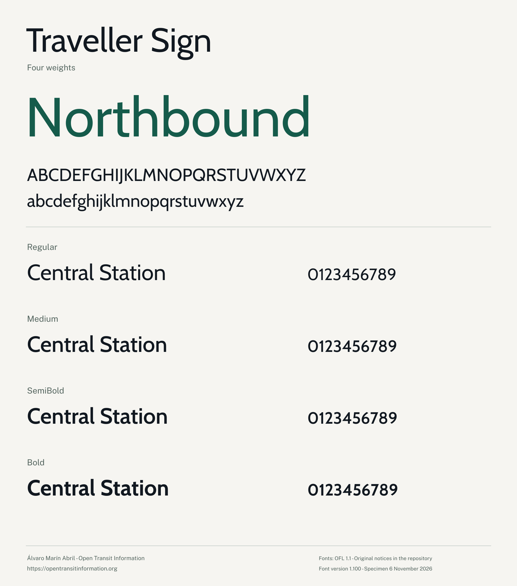

<!-- SPDX-License-Identifier: CC-BY-4.0 -->
# Traveller Sign and Traveller Screen

Two transport typeface families from [Open Transit Information](https://opentransitinformation.org).




Traveller Sign has four upright weights: Regular, Medium, SemiBold and Bold. Traveller Screen has those four weights and their genuine italics. The distribution provides desktop TTFs, WOFF2 web fonts and twelve editable UFO sources.

The published 1.1.0 release uses font software version 1.100. Its source, binaries and checksums are preserved in the matching [GitHub release](https://github.com/uningeniero/opentransitinformation-fonts/releases/tag/v1.1.0). The current source version is declared in `release.json`. Earlier releases remain available through their immutable tags and assets.

## Use

Install the required TTF files, or serve the WOFF2 files with your application. The declarations in `examples/fonts.css` identify each real weight and style. Set the document language so the shaping engine can apply its language rules.

Sign retains proportional default figures. Its optional `tnum` feature selects tabular figures; `pnum` restores proportional figures. Screen retains its default numerals and offers the optional `ss20` numeral profile. Select an available genuine style rather than synthesising bold or italic.

For the selected Greek and Cyrillic sign rows, choose the separately bundled **Source Sans 3 version 3.052** for the complete script run, including its figures, punctuation and marks. Its native family name, four weights and Adobe notices remain separate. The companion TTF and WOFF2 resources are unchanged official upstream files.

The repertoire and finite software checks are recorded in `tests/validation-spec.json`, `fonts/manifest.json` and `docs/qa.md`.

## Build

Use CPython 3.12.14. The build entry point creates an isolated versioned environment, installs the complete hash-pinned dependency lock and compiles the editable sources:

```sh
python build.py build
python build.py validate
python build.py reproduce
python build.py qa
```

To build one family, add `--family sign` or `--family screen` to each command. `bash sources/build.sh --family sign` runs the open source build for Traveller Sign. TTF and WOFF2 output directories are grouped by family; the TTF directory includes its exact OFL. Reproduction performs a second independent source build and compares every font byte. The Ubuntu workflow checks the two families independently. See [the production instructions](documentation/README.md).

The production command reads the editable UFO contours, components, anchors and text features. It uses Fontmake/ufo2ft, followed by the separate ttfautohint executable. It writes TTFs to `fonts/ttf/` and WOFF2 files to `fonts/woff2/` inside the selected build directory. `release.json` fixes the version and timestamp; `tools/production.json` identifies the tools and options. Validation separately checks the immutable 1.0.1 predecessor. The Makefile exposes the same commands, and `python build.py all` runs the build, validation, reproduction comparison and full primary QA in sequence.

Read `sources/ufo/README.md` for the source structure, recorded conversion inputs and subsequent constructions. Component normalisation can change point order; output hints are regenerated after that step.

The full primary Google Fonts profile runs without check exclusions or severity overrides. Raw FAIL, ERROR and FATAL findings retain their severity and produce a nonzero QA command status. Their exact disposition belongs in `docs/qa.md`; a recorded residual does not establish catalogue acceptance.

## Sources and licences

Font software and derivative drawings use the SIL Open Font License 1.1. Original notices, Reserved Font Names and contributor records accompany the fonts. Build code and CSS use Apache-2.0; first-party documentation uses CC-BY-4.0.

Keep the family OFLs, original notices and contributor records with redistribution. [AUTHORS.txt](AUTHORS.txt), [CONTRIBUTORS.txt](CONTRIBUTORS.txt), [NOTICE.md](NOTICE.md), the files under `licenses/` and the separate companion licence identify the applicable attribution. Technical provenance and source-construction records remain in `sources/`.

Source construction and release engineering are coordinated by Álvaro Marín Abril for [Open Transit Information](https://opentransitinformation.org). The [catalogue route](docs/google-fonts-route.md) records separate curation, contributor and disclosure requirements.

AI coding tools assisted source conversion, build implementation and QA analysis. Source records identify the retained upstream material and specific additions. Their copyright and licence obligations remain in force.
